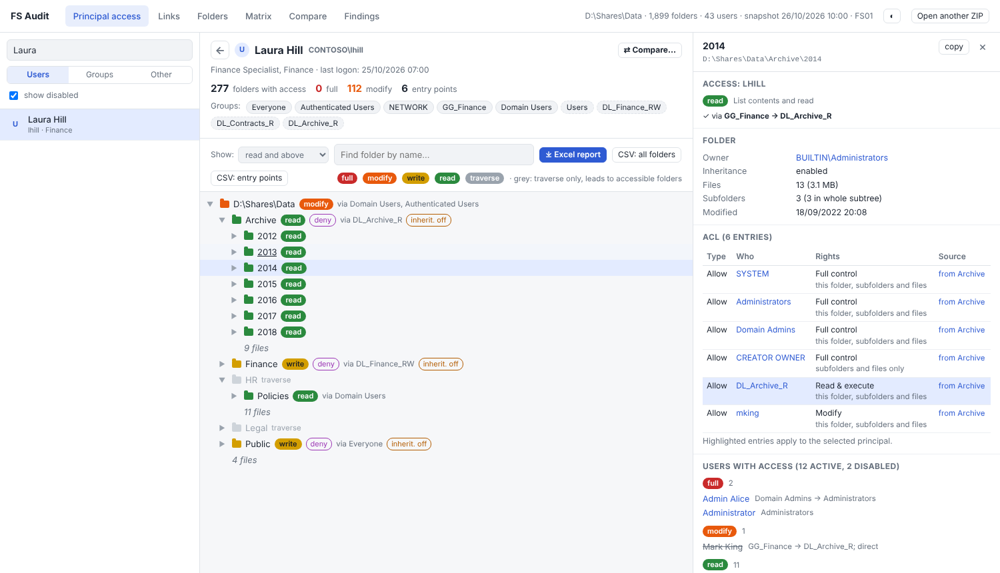
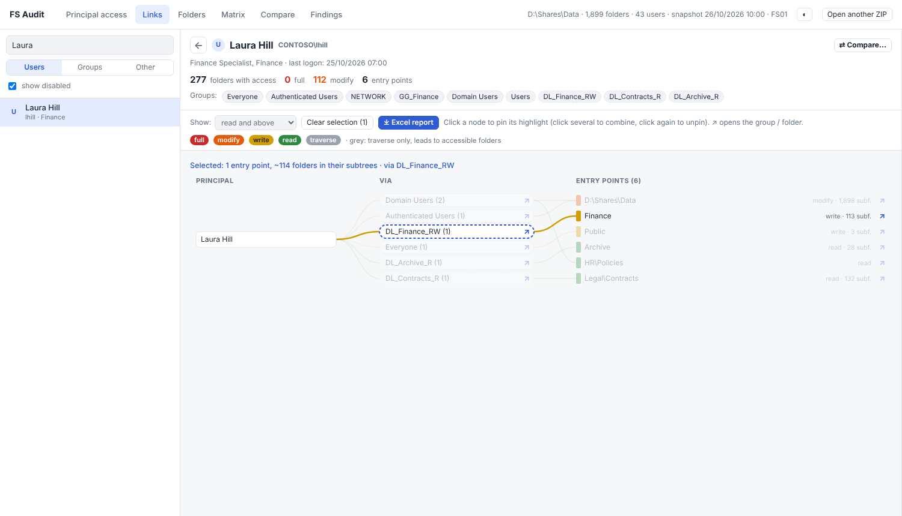
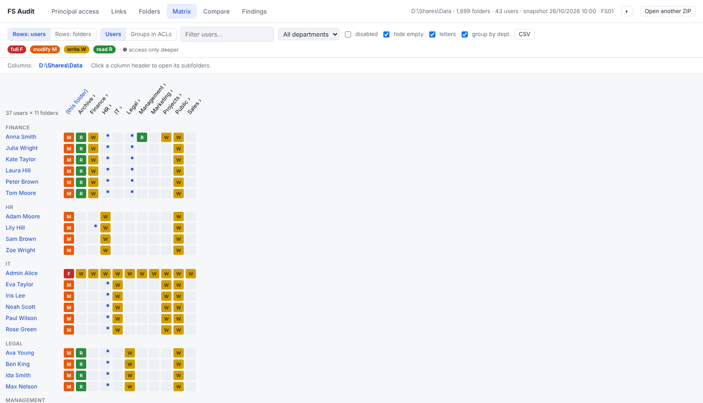
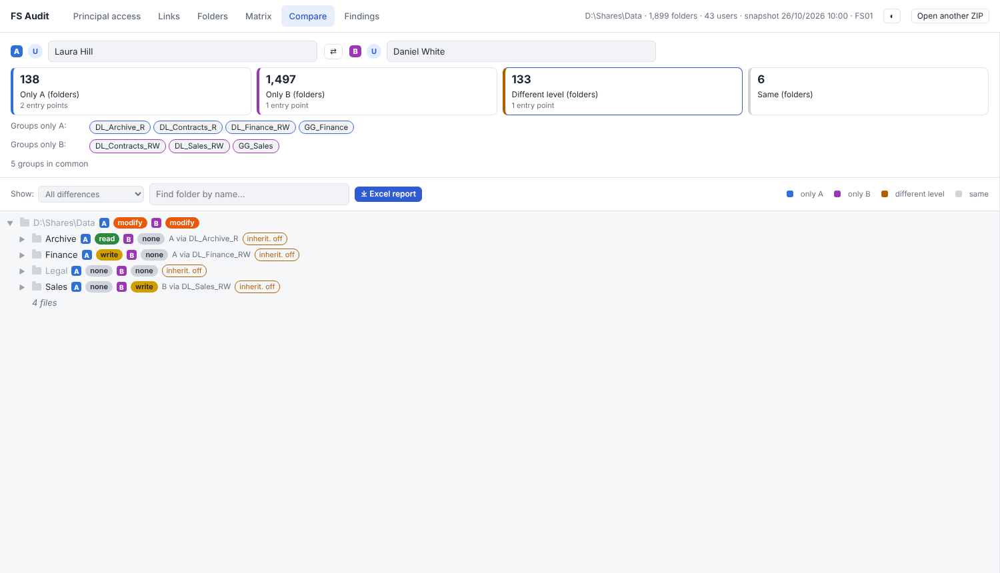
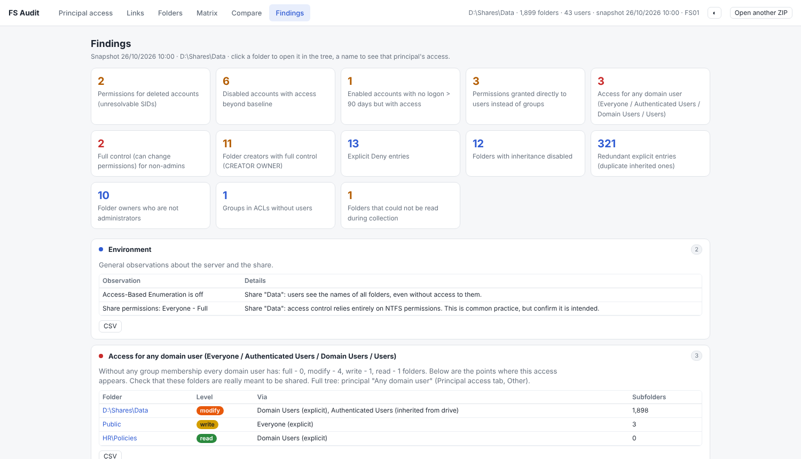

# FS Audit

**Who can access what on your Windows file server, and why.**

FS Audit is two small tools:

1. **`Collect-FSAudit.ps1`** - a read-only PowerShell collector. It walks a folder tree on a Windows file server and exports folder ACLs, owners, Active Directory users / groups / nested memberships, SMB share permissions and local groups to a set of CSV files (zipped).
2. **`FS-Audit-Viewer.html`** - a single, offline HTML file. Open it in a browser, drop the ZIP on it, and explore **effective access**: per user or group, per folder, as a graph, as a matrix, side-by-side comparisons, Excel reports and an automatic findings report.

No server, no database, no install. The data never leaves your machine: everything is computed in the browser.



---

## Features

**Viewer**

| Tab | What it shows |
|---|---|
| **Principal access** | Pick a user or group and see only the folders they can access, coloured by level (Full / Modify / Write / Read). Each folder says *via which group* access comes. Big folders show just a file count. Click a folder for its ACL (with the source folder of each inherited entry) and every user who can access it. |
| **Links** | The same as a graph: principal → groups → entry points (folders where access starts). Click nodes to pin highlights. |
| **Folders** | The whole tree. Select a folder to see who has access and why. |
| **Matrix** | Users (or groups) × folders. Drill into subfolders via column headers, or flip it to a folder tree × users. |
| **Compare** | Two users / groups side by side: folders only A can access, only B, different level, and the group-membership difference. Handy for "give the new hire the same access as a colleague". |
| **Findings** | Automatic audit report: access every domain user gets, full control for non-admins, ACEs for deleted accounts (orphaned SIDs), disabled / stale accounts that still have access, permissions granted directly to users, CREATOR OWNER full control, explicit Deny, broken inheritance, redundant explicit ACEs, non-admin owners, unreadable folders. |

- **Excel reports** (styled `.xlsx`, generated in the browser) for a principal (summary, entry points, all folders, groups, members) and for a comparison.
- CSV export for every table.
- Light / dark theme, resizable side panel, `Esc` to close a panel / deselect.

**Effective-access model.** NTFS DACL (explicit + inherited, ordered evaluation: Deny before Allow, explicit before inherited), generic-rights mapping, inherit-only / no-propagate flags, nested AD groups (incl. primary group, foreign security principals, Everyone / Authenticated Users), and share permissions as a cap. Folder level only; conditional ACEs (claims) are not evaluated. For disputed cases compare with *Properties → Security → Advanced → Effective Access* in Windows.

| Links | Matrix |
|---|---|
|  |  |
| **Compare** | **Findings** |
|  |  |

---

## Quick start

### Try it with demo data

Open `FS-Audit-Viewer.html` in Chrome / Edge / Firefox and drop [`demo/demo-audit.zip`](demo/demo-audit.zip) on it. The demo is a made-up company (*Contoso*) with planted problems for the Findings tab.

### 1. Collect (on the file server)

Run PowerShell **as Administrator** on the file server (Windows Server 2016+; PowerShell 5.1 or 7):

```powershell
Unblock-File .\Collect-FSAudit.ps1

# quick test on a small folder, without AD
powershell -ExecutionPolicy Bypass -File .\Collect-FSAudit.ps1 -RootPath 'D:\Shares\Data\IT' -OutputDir 'C:\FSAudit\Test1' -SkipAD

# full run
powershell -ExecutionPolicy Bypass -File .\Collect-FSAudit.ps1 -RootPath 'D:\Shares\Data'
```

Result: `C:\FSAudit\Audit_<timestamp>.zip`. About 115,000 folders take roughly 10 minutes.

| Parameter | Description |
|---|---|
| `-RootPath` | Folder to audit (required unless `-SkipFolders`). |
| `-OutputDir` | Where to write results. Must be outside `RootPath` and empty / non-existent. Default `C:\FSAudit\Audit_<timestamp>`. |
| `-SkipAD` | Skip the AD export (e.g. no RSAT on the server). |
| `-SkipFolders` | Only AD / shares, e.g. on an admin workstation with RSAT. |
| `-SkipLocal`, `-SkipShares` | Skip local groups / SMB shares. |
| `-NoZip` | Don't create the ZIP. |

If the file server has no ActiveDirectory module, run `-SkipFolders -SkipLocal -SkipShares` on a machine with RSAT and put the `ad_*.csv` files into the same ZIP.

### 2. View

Open `FS-Audit-Viewer.html` and drop the ZIP (or all CSV files) on it.

---

## Safety

The collector is **read-only**:

- only read APIs are used: directory enumeration, `GetAccessControl`, `Get-AD*`, `Get-SmbShare*`, `Get-LocalGroup`, SID translation;
- no calls that change ACLs, owners or attributes, or that move, rename or delete anything;
- **files are never opened**; only names and sizes come from the directory listing;
- no ownership is taken and denied folders are not bypassed; they are just logged to `errors.csv`;
- it writes **only** into `-OutputDir`, which must be outside the scanned tree and empty, so nothing is overwritten.

Check it yourself before running:

```powershell
Select-String .\Collect-FSAudit.ps1 -Pattern 'Set-Acl|SetAccessControl|SetOwner|Remove-Item|Move-Item|Rename-Item|takeown|icacls|Set-Content|\.Delete\('
```

**The output is sensitive.** It contains your whole folder structure, permissions and account list. Store it accordingly.

---

## Output format

UTF-8 CSV files in one folder / ZIP:

| File | Content |
|---|---|
| `folders.csv` | One row per folder: `Id, ParentId, Depth, Path, Name, OwnerSid, InheritanceDisabled, AclId, ExplicitAceCount, InheritedAceCount, FileCount, FileBytes, SubfolderCount, LastWriteUtc, Error` |
| `acl_entries.csv` | Unique ACLs (shared by many folders): `AclId, Order, Sid, AccessType, RightsMask, Rights, InheritanceFlags, PropagationFlags, IsInherited` |
| `sids.csv` | Every SID seen, with its resolved name |
| `ad_users.csv`, `ad_groups.csv`, `ad_computers.csv`, `ad_members.csv` | AD objects and direct memberships (incl. primary group) |
| `local_*.csv` | Local users / groups of the server (not on domain controllers) |
| `shares.csv`, `share_access.csv` | SMB shares and share permissions |
| `errors.csv`, `run.log`, `meta.json` | Errors, log, run metadata |

ACLs are de-duplicated: a typical tree with 100k+ folders has only a few hundred unique ACLs.

---

## Repository layout

```
Collect-FSAudit.ps1        collector
FS-Audit-Viewer.html       built viewer (single file, open this)
viewer/src.html            viewer source
viewer/build.py            inlines JSZip into src.html -> FS-Audit-Viewer.html
tools/make-demo-data.py    generates demo/demo-audit.zip (fictional data)
demo/demo-audit.zip        demo dataset
```

Rebuild the viewer after editing `viewer/src.html`:

```bash
npm pack jszip@3.10.1 && tar xzf jszip-3.10.1.tgz
python viewer/build.py package/dist/jszip.min.js
```

## License

MIT - see [LICENSE](LICENSE). The viewer bundles [JSZip](https://stuk.github.io/jszip/) 3.10.1 (MIT), see [THIRD-PARTY-NOTICES.md](THIRD-PARTY-NOTICES.md).
